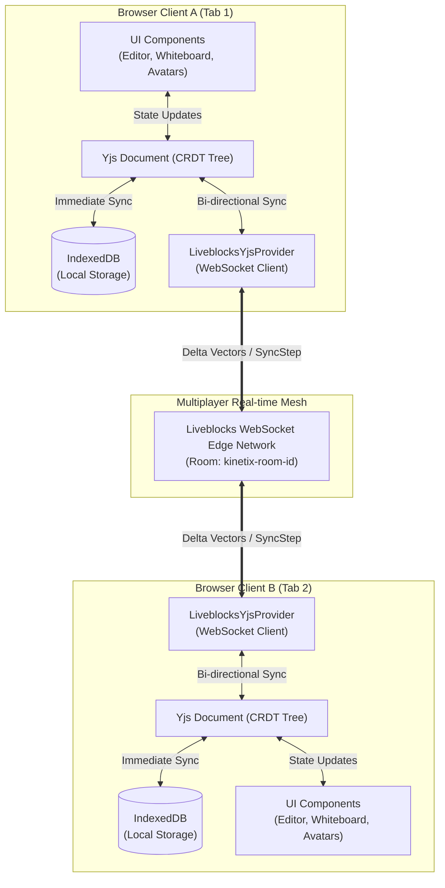

# Kinetix ⚡

> **Local-First, Offline-Capable Collaborative Markdown & Whiteboard Workspace**  
> Built with Next.js 16, React 19, Yjs CRDTs, IndexedDB, and Liveblocks WebSockets.

---

## 🌟 Overview

**Kinetix** is a high-performance, local-first collaborative productivity workspace. Inspired by tools like Notion and Linear, Kinetix solves the fundamental latency and offline-resilience problems of traditional cloud-first web apps by treating the browser as the primary source of truth.

Every keystroke and canvas stroke writes directly to an in-memory **Conflict-Free Replicated Data Type (CRDT)** document backed by browser **IndexedDB**. When online, edits broadcast with sub-millisecond latency to peers over **WebSockets**. When offline, users can continue editing indefinitely—reconnection initiates an automatic, mathematical convergence that merges conflicting edits without data loss.

---

## 🏗️ System Architecture



---

## 🔬 CRDT Deep Dive: How Conflict Resolution Works

### 1. The Flaw of Traditional REST / Last-Write-Wins (LWW)
In a standard client-server architecture:
- User A and User B fetch document revision `v1`.
- User A types `"Hello"` and saves at `12:00:01`.
- User B types `"World"` and saves at `12:00:02`.
- User B's payload completely **overwrites** User A's changes.

### 2. Yjs Mathematical Convergence
Kinetix models the workspace using **Yjs CRDTs**:
- **Text Layer (`Y.Text`)**: Text is structured as a doubly-linked list of uniquely identifiable character chunks with `(clientID, clock)` Lamport timestamps.
- **Canvas Layer (`Y.Array`)**: Shapes and sticky notes are stored as structured CRDT elements.
- **Character-Level Prefix/Suffix Diffing**: Instead of naive full-string rewrites, Kinetix uses a custom delta diffing algorithm (`applyTextDelta`) that identifies common prefixes and suffixes, dispatching only the precise character insertions or deletions:

$$\text{Operation} = \text{Delete}(\text{start}, \text{deleteCount}) \cup \text{Insert}(\text{start}, \text{insertText})$$

- **Cursor Preservation**: As remote peer deltas arrive, local cursor positions transform dynamically based on previous operation offsets, ensuring the active caret never jumps while other users type.

---

## 🚀 Key Features

| Feature | Description |
|---|---|
| **Local-First Storage** | Zero-latency writes directly to IndexedDB. Survives browser restarts and page refreshes offline. |
| **Multiplayer Sync** | Sub-50ms peer synchronization via Liveblocks WebSocket rooms. |
| **Character-Level CRDT** | Prefix/suffix delta diffing prevents full-text overwrites and preserves collaborator cursor positions. |
| **Live Markdown Preview** | Split-pane markdown editing powered by `react-markdown` and GitHub Flavored Markdown (`remark-gfm`). |
| **Collaborative Whiteboard** | Real-time SVG canvas with freehand pen drawing, draggable sticky notes, color palettes, and eraser. |
| **Workspace Modes** | Switch seamlessly between **Document Mode**, **Whiteboard Mode**, and **Split View**. |
| **Multiplayer Awareness** | Dynamic collaborator avatars with custom color assignments, hover tooltips, and active counts. |
| **Offline Simulator** | One-click toggle to disconnect WebSockets for offline stress testing and conflict-resolution demos. |
| **Export to Markdown** | Instant client-side `.md` document download with sanitized filenames. |

---

## 🛠️ Tech Stack

- **Framework**: [Next.js 16 (App Router)](https://nextjs.org) with [React 19](https://react.dev)
- **CRDT Core**: [Yjs](https://yjs.dev)
- **Offline Persistence**: [`y-indexeddb`](https://github.com/yjs/y-indexeddb)
- **Real-Time Network**: [`@liveblocks/client`](https://liveblocks.io), [`@liveblocks/react`](https://liveblocks.io), [`@liveblocks/yjs`](https://liveblocks.io)
- **Styling**: [Tailwind CSS v4](https://tailwindcss.com)
- **Icons**: [Lucide React](https://lucide.dev)
- **Markdown**: `react-markdown` + `remark-gfm`

---

## 🎮 Recruiter & Interviewer Demo Guide

To demonstrate the local-first CRDT conflict resolution live in under 60 seconds:

1. **Open Two Browser Windows**:
   - Open `http://localhost:3000` in Window A.
   - Open the same URL in Window B (or an Incognito window).
2. **Observe Real-Time Collaboration**:
   - Notice both user avatars appear in the header.
   - Type in Window A; observe instantaneous updates in Window B.
3. **Simulate Offline Disconnection**:
   - In Window A, click the **"Simulate Offline"** button.
   - The status badge transitions to `Offline (Simulated) — Local Buffer`.
4. **Make Conflicting Edits**:
   - In Window A (offline), write a new paragraph or sketch on the whiteboard.
   - In Window B (online), make edits in a different section of the document.
5. **Reconnect & Witness Convergence**:
   - In Window A, click **"Reconnect Sync"**.
   - Notice the state vectors exchange over WebSockets and **mathematically merge both sets of changes** seamlessly with zero data loss and zero cursor jumping.
6. **Export**:
   - Click **"Export .md"** to download the clean markdown file.

---

## 🏁 Getting Started

### Prerequisites
- Node.js 18+ or 20+
- A free [Liveblocks](https://liveblocks.io) account (for the public API key)

### 1. Clone & Install
```bash
git clone https://github.com/your-username/kinetix.git
cd kinetix
npm install
```

### 2. Configure Environment Variables
Create a `.env.local` file in the root directory:
```env
NEXT_PUBLIC_LIVEBLOCKS_PUBLIC_KEY=pk_live_your_key_here
```

### 3. Run Development Server
```bash
npm run dev
```
Open [http://localhost:3000](http://localhost:3000) to launch Kinetix.

### 4. Build for Production
```bash
npm run build
npm run start
```

---

## 📄 License
MIT License. Built with passion for local-first software and modern distributed systems.
